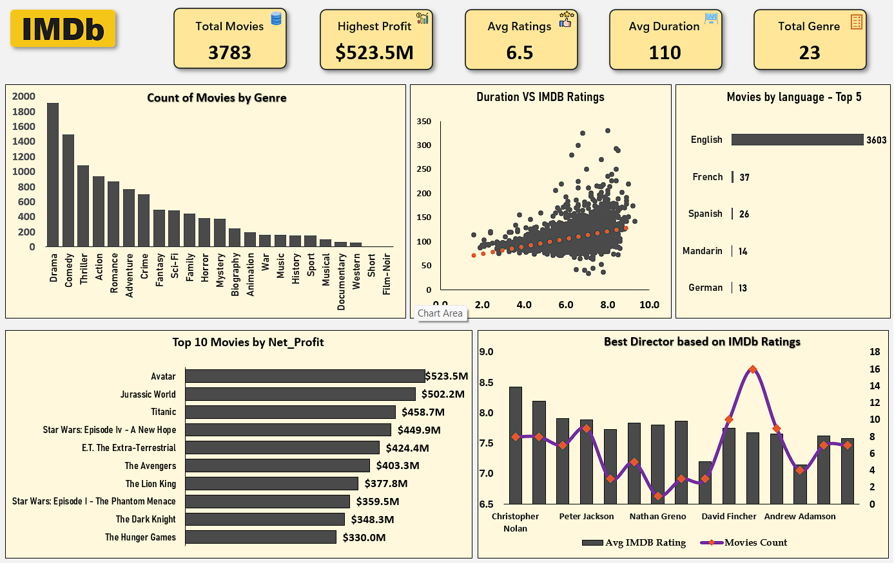

# IMDb Movie Data Analysis

## Project Overview

This project uses Microsoft Excel to analyze movie data, focusing on
IMDb ratings, genres, directors, movie duration, languages, and
profitability.

The goal is to clean and analyze the data, then present key findings in
an Excel dashboard.

## Objectives

-   Explore movie counts across genres and languages.
-   Compare movie duration with IMDb ratings.
-   Identify the top 10 movies by net profit.
-   Compare directors using average IMDb ratings and movie counts.
-   Summarize key metrics in a dashboard.

## Tools Used

-   Microsoft Excel
-   Excel formulas and functions
-   PivotTables and PivotCharts
-   Data cleaning and formatting
-   Dashboard visualization

## Project Workflow

1.  **Raw Data:** Keep the original dataset separate from the analysis
    workbook.
2.  **Data Cleaning:** Check missing values and duplicates, and prepare
    the data for analysis.
3.  **Data Analysis:** Use Excel formulas, summary statistics, and
    PivotTables.
4.  **Visualization:** Create charts to compare genres, languages,
    ratings, profitability, and director performance.
5.  **Dashboard:** Present key metrics and charts in one dashboard.

## Dashboard Preview

## Key Dashboard Metrics

-   **Total Movies:** 3,783
-   **Highest Net Profit:** \$523.5M
-   **Average IMDb Rating:** 6.5
-   **Average Duration:** 110 minutes
-   **Total Genres:** 23

*Metrics are based on the current version of the workbook and should be
checked against the final analysis before publication.*

## Key Analysis Areas

-   Count of movies by genre.
-   Relationship between movie duration and IMDb ratings.
-   Top five languages by movie count.
-   Top 10 movies by net profit.
-   Director performance based on average IMDb rating and movie count.

## Files Included

  -----------------------------------------------------------------------
  File                                Description
  ----------------------------------- -----------------------------------
  `imdb_movie_raw_data.xlsx`          Original raw movie dataset

  `imdb_movie_analysis.xlsx`          Excel workbook containing the
                                      analysis and dashboard

  `imdb_dashboard.png`                Dashboard screenshot
  -----------------------------------------------------------------------

## Key Learnings

-   Preparing and cleaning data in Excel.
-   Using formulas and statistical functions.
-   Analyzing data with PivotTables.
-   Building charts and combining them into a dashboard.
-   Communicating findings through data visualization.

## Conclusion

This project demonstrates how Microsoft Excel can be used to clean,
analyze, and visualize movie data. It also provides a foundation for
future projects using SQL and Power BI.

------------------------------------------------------------------------

**Author:** Abhay Sharde\
**Tools:** Microsoft Excel
